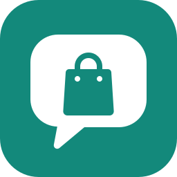

# Shopping List for Bring!

A plugin for the Pebble app that adds things to your [Bring!](https://www.getbring.com) shopping lists by voice
with the Index 01 ring and shows your lists on your Pebble.

**Developers:** to build, test, sideload or publish the plugin, or to see how it works, read
**[DEVELOPMENT.md](DEVELOPMENT.md)**.

> **Unofficial.** Not affiliated with, endorsed, sponsored or approved by Bring! Labs AG. "Bring!" is a
> trademark of Bring! Labs AG and is used here only to say which service this works with. Bring! has no public
> API. The plugin uses the same web API as Bring!'s own apps, which Bring! Labs can change or block at any
> time. Use it at your own risk. See [Legal](#legal).

## What it does

- **Add by voice:** tell your Index ring "Add milk and two packs of butter to Bring" and the items appear on
  your Bring! list. Name a list to use another one: "…to the party list".
- **Check off and read:** "I bought the milk", or "What's on my shopping list?"
- **Show on your Pebble:** watchfaces and apps that support plugins can show your lists and items.
- **Proper Bring! items:** names are matched with Bring!'s catalog, so "Müsli" or "milk" get their usual icon
  and section. Items already on the list aren't added twice.
- **Shopping only:** your reminders and to-dos never go to Bring!. They stay wherever Index keeps them now.

## Install

You need the Pebble app 1.18 or later.

1. In the Pebble app, open **Settings → Plugins** and turn on **Plugins / permissions preview**.
2. Install **[Shopping List for Bring!](https://apps.repebble.com/5e2b3937f0814d3e944258a5)** from the
   Pebble app store (or search for it in the Pebble app). When asked, allow it to connect to
   `api.getbring.com` and `web.getbring.com`.
3. Open **Apps → Plugins → Shopping List for Bring!** and its settings page. Sign in with your Bring! email and
   password, then pick your default list. If you sign in to Bring! with Google or Apple, set a password in the
   Bring! app first (Profile → Account).
4. Type something under **Try it** on the settings page and check it appears in Bring!.

## Using it with Index

Mention Bring! and the Index agent sends the items there: "Add milk to Bring", "Setz Müsli auf die
Bring-Liste". Index also has its own built-in shopping list. For a vague "add milk to the list", Index may choose
its own list instead, so naming Bring! is the reliable way.

Items go to your default list unless you name another one of your Bring! lists. Change the default on the
settings page.

## On the watch

The plugin has no watch app of its own. Use a watchface or app that supports plugins, such as **Dashboard
(Plugin Demo)**. There, a tile can show how many items are on your list, and tapping an item tile checks it off.

## Privacy

Your Bring! password goes only to Bring! and isn't stored. Your lists only move between your phone and Bring!.
Nothing reaches the author or any other server. Details in [PRIVACY.md](PRIVACY.md).

## Development

Building, testing, sideloading and publishing the plugin, how it works with Index, and notes on Bring!'s API
are in **[DEVELOPMENT.md](DEVELOPMENT.md)**.

## Legal

- **License:** [Apache License 2.0](LICENSE), Copyright 2026 Samuel Barabas. See [NOTICE](NOTICE) for
  third-party material.
- **No affiliation:** an independent project, not affiliated with, endorsed, sponsored or approved by Bring!
  Labs AG, Core Devices or the owners of the Pebble trademark.
- **Trademarks:** "Bring!" is a trademark of Bring! Labs AG. "Pebble" and "Index 01" are trademarks of their
  respective owners. They are used only to say what this works with.
- **No warranty:** provided "as is", without warranty of any kind. Bring! Labs can change or block its API, or
  restrict accounts under its [terms of use](https://getbring.com/en/terms-of-use), at any time.
